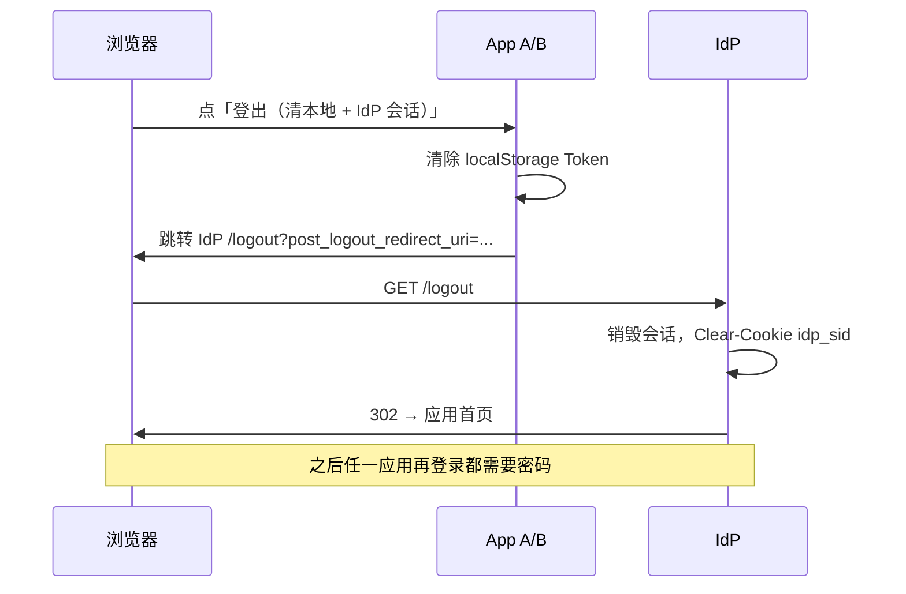

# React + NestJS 单点登录（SSO）教学 Demo

用 **OIDC Authorization Code + PKCE** 演示「一个身份提供方、两个前端应用」的 SSO：

| 服务 | 角色 | 地址 |
|------|------|------|
| IdP (`apps/idp`) | NestJS 最小身份提供方 | http://localhost:3000 |
| App A (`apps/app-a`) | 门户 SPA（React + Vite） | http://localhost:5173 |
| App B (`apps/app-b`) | 后台 SPA（React + Vite） | http://localhost:5174 |

> 仅供本地学习，勿用于生产。密钥、密码均为演示默认值。

---

## 1. 安装与启动

需要 Node.js ≥ 18。

```bash
cd sso-react-nestjs-demo
npm install

# 同时启动 IdP + App A + App B
npm run dev
```

分别启动也可以：

```bash
npm run dev:idp     # :3000
npm run dev:app-a   # :5173
npm run dev:app-b   # :5174
```

构建 / 类型检查：

```bash
npm run build
npm run typecheck
```

环境变量示例见根目录与各应用下的 `.env.example`。前端已自带可运行的 `.env`。

---

## 2. 演示账号

| 用户名 | 密码 | 说明 |
|--------|------|------|
| `demo` | `demo123` | 普通用户 |
| `admin` | `admin123` | 含 `admin` 角色 |

---

## 3. 点击路径：亲手感受 SSO

1. 打开 **App A** http://localhost:5173 → 点「使用 SSO 登录」
2. 浏览器跳到 IdP 登录页 → 用 `demo` / `demo123` 登录
3. 回到 App A，看到用户信息与截断后的 Token
4. 点右上角 **打开后台 App B**（或新开 http://localhost:5174）
5. 在 App B 点「使用 SSO 登录」→ **不应再要求输入密码**，短暂跳转后直接登录成功
6. 对比实验：
   - App A 点「仅清本地 Token」→ App A 显示未登录，但再点登录仍免密（IdP Cookie 还在）
   - 任一侧点「登出（清本地 + IdP 会话）」→ 再登录任一应用都要重新输密码

---

## 4. 协议走读（authorize → code → token → userinfo）

### 4.1 为什么是 Authorization Code + PKCE？

- SPA **不能安全保存** `client_secret`，因此是 public client。
- 授权码模式把「拿 Token」放到前端与 IdP 的后端通道（`/token`），避免 Implicit 把 Token 挂在 URL 片段里。
- **PKCE**：前端本地生成 `code_verifier`，只把 SHA-256 摘要 `code_challenge` 发给 `/authorize`；换 Token 时必须出示原始 verifier。即便授权码被截获，没有 verifier 也无法换 Token。

### 4.2 Cookie 与 Token 各自干什么？

| 凭证 | 存在哪 | 作用 |
|------|--------|------|
| `idp_sid` 会话 Cookie | **IdP 域名**（localhost:3000） | 证明「用户已在 IdP 登录过」。App B 再访问 `/authorize` 时浏览器自动带上 → **跳过密码**（SSO） |
| `access_token` / `id_token` | **各 SPA 自己的** localStorage | 调用 API / 展示用户。A、B **不共享** Token；各自走一遍 code 换 Token |

关键洞察：**SSO 共享的是 IdP 会话，不是 access_token。**

### 4.3 为什么 App B 不用再输密码？

App A 登录成功后，IdP 种下 `idp_sid`（`SameSite=Lax`，适合顶层重定向）。  
App B 发起登录时仍会跳到同一个 IdP 的 `/authorize`；因为 Cookie 仍在，IdP 识别到会话，**直接签发新的 authorization code**（本 Demo 跳过同意页），再重定向回 App B 的 `/callback` 换 Token。用户只看到「闪一下」而无需密码。

---

## 5. 时序图

### 登录（含 SSO 第二次）

```mermaid
sequenceDiagram
  autonumber
  participant UA as 浏览器
  participant A as App A :5173
  participant B as App B :5174
  participant IdP as IdP :3000

  Note over UA,IdP: —— 首次：App A 登录 ——
  UA->>A: 打开门户 / 点登录
  A->>A: 生成 state/nonce/code_verifier<br/>保存 verifier 到 sessionStorage
  A->>UA: 302 → IdP /authorize?code_challenge=...
  UA->>IdP: GET /authorize（尚无 Cookie）
  IdP->>UA: 302 → /login?continue=...
  UA->>IdP: POST /login（demo/demo123）
  IdP->>UA: Set-Cookie: idp_sid=...; SameSite=Lax
  IdP->>UA: 302 → /authorize（continue）
  UA->>IdP: GET /authorize（带 idp_sid）
  IdP->>IdP: 校验 client/PKCE，签发 code
  IdP->>UA: 302 → AppA/callback?code&state
  UA->>A: 打开 /callback
  A->>IdP: POST /token（code + code_verifier）
  IdP->>A: access_token + id_token
  A->>IdP: GET /userinfo (Bearer)
  IdP->>A: 用户声明
  A->>UA: 展示已登录

  Note over UA,IdP: —— SSO：App B 免密 ——
  UA->>B: 打开后台 / 点登录
  B->>UA: 302 → IdP /authorize（新的 PKCE）
  UA->>IdP: GET /authorize（仍带 idp_sid）
  IdP->>IdP: 会话有效 → 直接发 code（跳过登录页）
  IdP->>UA: 302 → AppB/callback?code&state
  B->>IdP: POST /token + /userinfo
  B->>UA: 展示已登录（未再输密码）
```

### 登出



---

## 6. 仓库结构

```
sso-react-nestjs-demo/
├── apps/
│   ├── idp/                 # NestJS 教学 IdP（OIDC 子集）
│   ├── app-a/               # 门户 React SPA
│   └── app-b/               # 后台 React SPA
├── packages/
│   └── oidc-client/         # 共享的浏览器端 OIDC+PKCE 客户端
├── package.json             # npm workspaces
└── README.md
```

IdP 关键端点：

- `GET /.well-known/openid-configuration`
- `GET /authorize`
- `POST /token`
- `GET /userinfo`
- `GET /jwks.json`
- `GET|POST /logout`、`GET|POST /login`

代码里在 **redirect / callback / token exchange** 处有简短中英文注释，建议边跑边看 `packages/oidc-client/src/client.ts` 与 `apps/idp/src/oidc/oidc.controller.ts`。

---

## 7. 已知限制（刻意简化）

- 会话与授权码存在 **内存**，重启 IdP 即失效
- RSA 密钥进程内临时生成，未持久化
- 无刷新令牌、无同意（consent）页、无动态客户端注册
- SPA 侧仅校验 ID Token 的 `nonce`，未用 JWKS 做完整签名校验（生产必须校验）
- 密码用 SHA-256 演示，非 bcrypt/argon2
- 未实现资源 API（可用 `/userinfo` 体会 Bearer 校验）

---

## 8. 许可证

教学示例，按需自行使用与修改。
